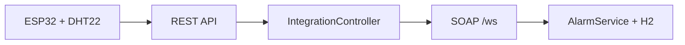

# Fristående IoT-larmtjänst

En individuell IoT-lösning som läser luftfuktighet med en ESP32 och DHT22, tar emot mätningen via REST/JSON och skickar den vidare till en SOAP-baserad larmtjänst. Enheter, gränsvärden och larm lagras i en lokal H2-databas.

> **Status:** REST- och SOAP-flödet har körts i IntelliJ, Postman och SoapUI. ESP32-firmware och den fysiska sensorn behöver fortfarande provas på den faktiska hårdvaran.

## Flöde



REST-mottagningen kontrollerar att enheten är registrerad och att JSON-fälten stämmer. `IntegrationController` omvandlar mätningen till SOAP XML och anropar SOAP-tjänsten. `AlarmService` jämför värdet med en sparad gräns och skapar ett larm vid överskridande.

## Starta Java-tjänsten

### Förutsättningar

- JDK 21
- IntelliJ IDEA eller Maven

Öppna mappen `alarm-service` i IntelliJ och starta `AlarmServiceApplication`. Med Maven kan tjänsten startas från den mappen:

```bash
mvn spring-boot:run
```

Tjänsten kör på port `8083`.

| Funktion | Adress |
|---|---|
| Registrera enhet | `POST http://localhost:8083/api/devices` |
| Skicka mätning | `POST http://localhost:8083/api/measurements` |
| SOAP endpoint | `http://localhost:8083/ws` |
| WSDL | `http://localhost:8083/ws/alarm.wsdl` |
| H2 Console | `http://localhost:8083/h2-console` |

## REST-funktioner

<details>
<summary>🫧 Registrera enhet — POST /api/devices</summary>

Registrerar en enhet innan den skickar mätningar. Alla fält krävs. En ny registrering svarar `201 Created`; en redan registrerad enhet med samma inställningar svarar `200 OK`.

```json
{
  "deviceId": "Hum-01",
  "measurementType": "humidity",
  "unit": "%"
}
```

Om enheten redan finns med andra mätinställningar svarar tjänsten `409 Conflict`.

</details>

<details>
<summary>🫧 Ta emot mätning — POST /api/measurements</summary>

Tar emot JSON, validerar enhets-ID, mättyp, enhet, värde och tidsstämpel. Enheten måste först vara registrerad. Därefter skickas mätningen till SOAP-operationen `ProcessMeasurement`.

```json
{
  "deviceId": "Hum-01",
  "measurementType": "humidity",
  "value": 58.4,
  "unit": "%",
  "timestamp": "2026-10-25T12:30:45Z"
}
```

Ett mottaget anrop svarar `201 Created`. Exempel när inget larm behövs:

```json
{
  "accepted": true,
  "alarmCreated": false,
  "alarmId": null,
  "message": "No alarm created; value is within the allowed limit"
}
```

Om luftfuktigheten är högre än 60 % skapas ett larm och svaret innehåller dess ID. Ogiltiga eller saknade fält ger `400 Bad Request`; en oregistrerad enhet ger `403 Forbidden`; ett SOAP-fel ger `502 Bad Gateway`.

</details>

## SOAP-funktioner

SOAP-kontraktet har namespace `urn:simon:iot:alarm:v1`. Importera WSDL-adressen i SoapUI för att skapa requests automatiskt:

```text
http://localhost:8083/ws/alarm.wsdl
```

<details>
<summary>🫧 ProcessMeasurement — bedöm en mätning</summary>

Tar emot en mätning, hämtar rätt gränsvärde och skapar ett larm om värdet ligger över gränsen. Med standardgränsen 60 % skapar 58,4 % inget larm medan 68,2 % skapar ett.

Requesten innehåller `deviceId`, `measurementType`, `value`, `unit` och `timestamp`. Svaret innehåller `alarmCreated`, `message` och eventuellt `alarmId`.

</details>

<details>
<summary>🫧 GetAlarm — hämta ett larm</summary>

Hämtar ett larm med dess ID. Svaret innehåller `found` och, om larmet finns, bland annat enhets-ID, mättyp, värde, tid och meddelande. Ett ID som inte finns ger `found: false`.

</details>

<details>
<summary>🫧 GetAllAlarms — hämta alla larm</summary>

Returnerar alla sparade larm i databasen. Varje rad innehåller larm-ID, enhet, mättyp, värde, enhet, skapandetid och meddelande.

</details>

Ogiltiga SOAP-anrop och mätningar utan konfigurerat gränsvärde returnerar en SOAP Fault.

## Java-kodens huvuddelar

<details>
<summary>🫧 IntegrationController</summary>

REST-ingången. `registerDevice` sparar eller kontrollerar en enhet. `acceptMeasurement` validerar JSON, bygger SOAP XML och anropar SOAP-tjänsten via `WebServiceTemplate`.

</details>

<details>
<summary>🫧 AlarmEndpoint</summary>

Tar emot SOAP XML. `processMeasurement` hanterar mätningar, `getAlarm` hämtar ett larm och `getAllAlarms` listar alla larm. Endpointen bygger SOAP-svar enligt WSDL/XSD.

</details>

<details>
<summary>🫧 AlarmService</summary>

Innehåller larmregeln: hitta gränsvärde, kontrollera enhet och jämföra mätvärdet. Endast värden som överskrider gränsen sparas som larm.

</details>

<details>
<summary>🫧 Repositories och databasmodeller</summary>

`DeviceRepository`, `ThresholdRepository` och `AlarmRepository` läser och sparar enheter, gränsvärden och larm genom Spring Data JPA. Modellerna finns i `model`-paketet.

</details>

## Databas och gränsvärden

H2 lagrar data lokalt i `alarm-service/data/alarmdb`. Första uppstarten skapar tabeller och lägger in standardgränser:

| Mättyp | Gräns | Enhet |
|---|---:|---|
| humidity | 60 | % |
| temperature | 30 | °C |

H2 Console använder JDBC URL `jdbc:h2:file:./data/alarmdb`, användarnamn `sa` och tomt lösenord. Gränsvärdena skapas bara om de saknas, så ändringar i databasen finns kvar vid nästa uppstart.

## ESP32 och DHT22

### Koppling

| DHT22 | ESP32 |
|---|---|
| `+` | `3V3` |
| `OUT` | `GPIO4` / `D4` |
| `-` | `GND` |

### Konfigurera och ladda upp

1. Installera ESP32-kortstödet från Espressif i Arduino IDE.
2. Installera `DHT sensor library by Adafruit`.
3. Kopiera `producer-esp32/arduino_secrets.example.h` till `producer-esp32/arduino_secrets.h`.
4. Fyll i Wi-Fi-namn och lösenord.
5. Byt `192.168.1.50` till datorns lokala IPv4-adress i båda URL:erna. Hitta adressen med `ipconfig`.
6. Öppna `producer-esp32/producer-esp32.ino`, välj ESP32-kort och COM-port och ladda upp.
7. Öppna Serial Monitor på `115200 baud`.

ESP32 måste vara på samma lokala nätverk som datorn. Datorns brandvägg behöver tillåta anslutningar på port `8083`. Enheten försöker registrera sig vid start och skickar sedan luftfuktighet ungefär var 30:e sekund. Mätningar skickas med HTTP till den lokala tjänsten.

## Testa hela flödet

1. Starta Java-tjänsten.
2. Registrera `Hum-01` med `POST /api/devices`.
3. Skicka `58.4` till `POST /api/measurements`; kontrollera `alarmCreated: false`.
4. Skicka `68.2`; kontrollera `alarmCreated: true` och notera alarm-ID.
5. I SoapUI, kör `GetAlarm` med det ID:t.
6. Kör `GetAllAlarms` och kontrollera att larmet finns med.
7. När REST/SOAP-testet fungerar, anslut och prova ESP32-enheten.

## Projektfiler

```text
individual-assignment/
├── alarm-service/       Java, REST, SOAP, WSDL/XSD och H2
├── producer-esp32/      ESP32-program och konfigurationsexempel
├── demo/                Exempel på registrering och mätningar
└── README.md
```

`arduino_secrets.h` innehåller privata Wi-Fi-uppgifter och är ignorerad av Git. Lägg inte in den i GitHub.

## Avgränsning

Detta är en fristående individuell lösning med ett eget SOAP-kontrakt. Den behöver ingen annan gruppmedlems kod. Uppgiftsbladet nämner även ett gemensamt gruppkontrakt; kontrollera med läraren om din individuella inlämning ska använda det kontraktets exakta WSDL, operationer och namespace.
